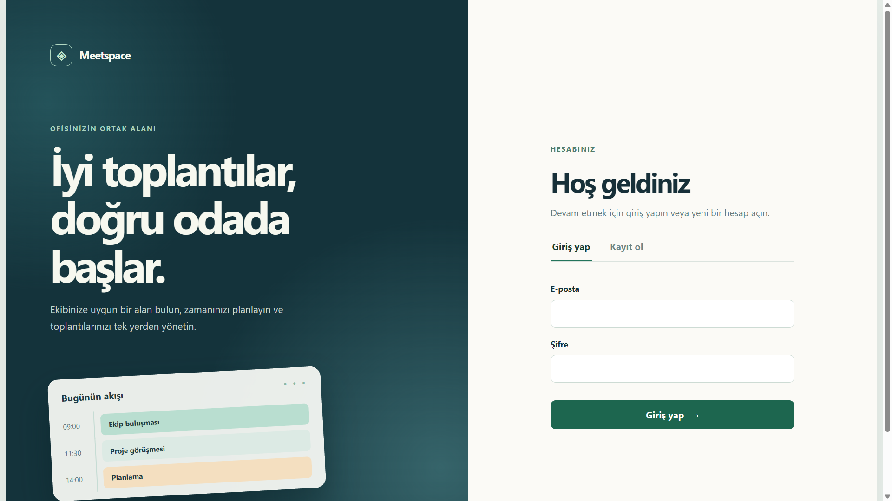
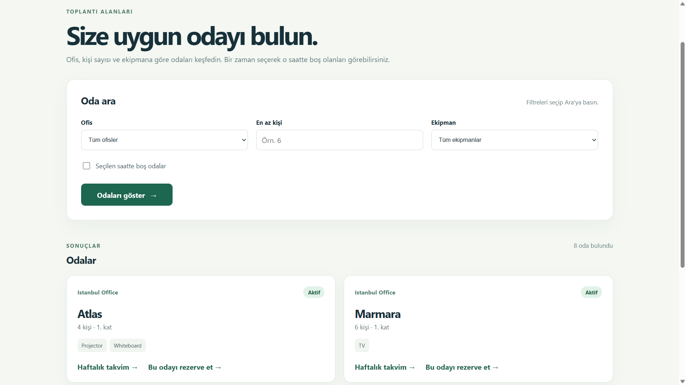
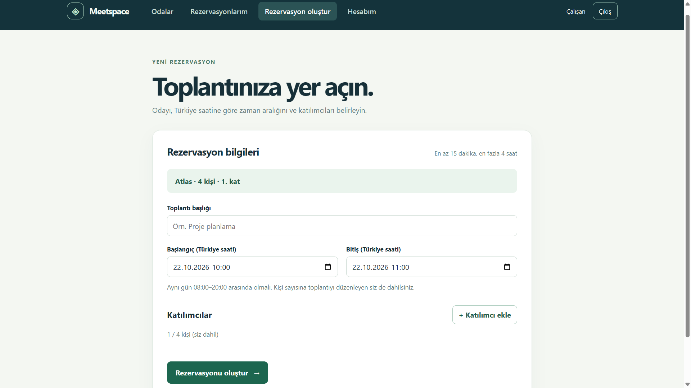
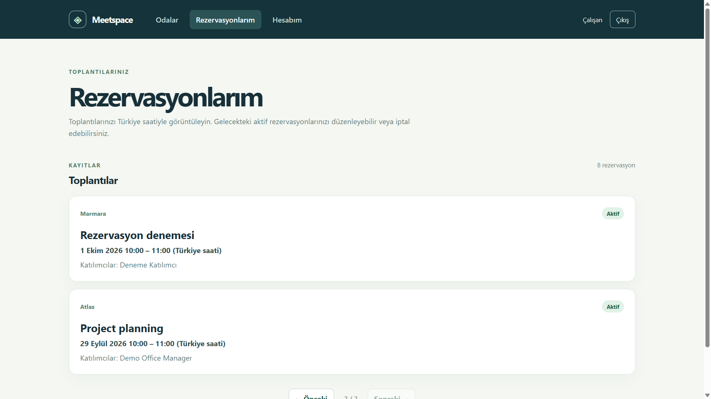
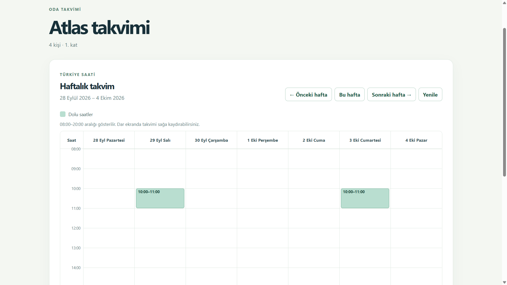
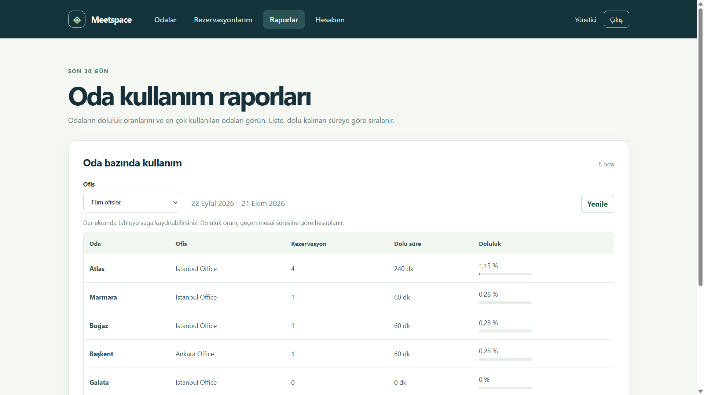
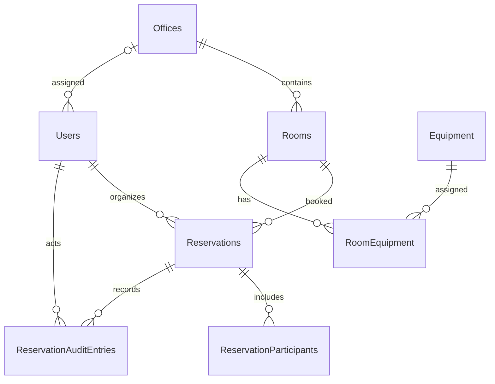

# Meeting Room Booking

Staj projesi: çalışanların toplantı odası bulup rezervasyon yapabildiği, yöneticilerin ofis ve odaları yönetip kullanım raporlarını görebildiği bir web uygulaması. Backend .NET 8 ASP.NET Core Web API, Entity Framework Core ve MySQL 8+ kullanır. Frontend yalnızca HTML, CSS ve saf JavaScript ile yazılmıştır. Rezervasyon oluşturma ve düzenleme sırasında MySQL satır kilidi aynı odada eşzamanlı çakışmayı engeller.

## Ekran görüntüleri

Ekranlar örnek verilerle gösterilmiştir; rezervasyon ve rapor tarihleri uygulamanın çalıştırıldığı güne göre değişir.

| Giriş | Oda arama ve listeleme |
| --- | --- |
|  |  |

| Rezervasyon oluşturma | Rezervasyonlarım |
| --- | --- |
|  |  |

| Haftalık oda takvimi | Admin oda kullanım raporu |
| --- | --- |
|  |  |

## Gerekenler

- .NET 8 SDK veya üzeri
- Git
- MySQL Server 8 veya üzeri; MySQL Workbench, veritabanını oluşturmak ve incelemek için kullanılabilir

## Veritabanı modelini kurma (Windows PowerShell)

1. `dotnet --version` komutuyla SDK'nın kurulu olduğunu kontrol et.
2. MySQL 8 sunucusunun çalıştığından emin ol. MySQL Workbench'te yerel bağlantını aç, yeni bir SQL sekmesinde `CREATE DATABASE IF NOT EXISTS meeting_room_booking CHARACTER SET utf8mb4 COLLATE utf8mb4_unicode_ci;` komutunu çalıştır. Kullandığın hesabın bu veritabanında tablo oluşturma yetkisi olmalı.
3. Repo kökünde `Copy-Item src/MeetingRoomBooking.Api/appsettings.Example.json src/MeetingRoomBooking.Api/appsettings.json` çalıştır. Oluşan `appsettings.json` içindeki `YOUR_DB_USER` ve `YOUR_DB_PASSWORD` alanlarını kendi MySQL bağlantı bilgilerinle değiştir. Workbench'e girişte kullandığın hesap aynı MySQL sunucusundaysa bu bilgileri kullanabilirsin. `Seed:DemoPassword` alanına en az 12 karakterlik ayrı bir test şifresi; `Jwt:Key` alanına en az 32 baytlık rastgele, gizli bir değer yaz. Gerçek şifrelerini veya bu dosyayı Git'e ekleme.
4. Repo kökünde `dotnet restore MeetingRoomBooking.sln` ve `dotnet build MeetingRoomBooking.sln` çalıştır.
5. `dotnet tool restore` çalıştır.
6. `dotnet ef database update --project src/MeetingRoomBooking.Data --startup-project src/MeetingRoomBooking.Api` çalıştır. Repodaki hazır migration veritabanına uygulanır; yeniden `migrations add InitialCreate` çalıştırma.
7. `dotnet run --project src/MeetingRoomBooking.Api --no-launch-profile -- --urls http://localhost:5080` çalıştır. İlk açılışta boş veritabanına örnek veriler eklenir.
8. Tarayıcıda arayüz için `http://localhost:5080/`, API uçlarını denemek için `http://localhost:5080/swagger` ve sağlık kontrolü için `http://localhost:5080/api/status` adreslerini aç. Bilgisayarında x64 SDK ile uyumlu ASP.NET Core 8 çalışma zamanı da kurulu olmalı; uygulama başlarken bir framework eksikliği bildirirse `dotnet --list-runtimes` ile kontrol et.

`src/MeetingRoomBooking.Api/appsettings.Example.json` yalnızca ayarların biçimini gösterir. Gerçek bağlantı ve JWT sırları Git'e yüklenmez. `InitialCreate` migration dosyaları repoda bulunur; içlerinde şifre olmamalıdır. Model değişikliği yapıldığında yeni isimli migration oluşturulur.

## Veritabanı şeması

`RevokedTokens` tablosu JWT çıkış işlemleri için ayrılmıştır. Rezervasyon oluşturma işleminde `READ COMMITTED` MySQL transaction başlatılır ve ilgili `Rooms` satırı `SELECT ... FOR UPDATE` ile kilitlenir. Aktif rezervasyonların çakışması (`StartUtc < yeniBitiş` ve `EndUtc > yeniBaşlangıç`) kilit tutulurken sorgulanır; yeni rezervasyon ve katılımcıları aynı transaction içinde kaydedilip ardından commit edilir. Aynı odaya gelen ikinci istek kilit açılana kadar bekler, sonra güncel rezervasyonları görür ve çakışıyorsa 409 `ROOM_CONFLICT` döner. Düzenleme işleminde eski ve yeni odanın satırları ID sırasıyla kilitlenir; önce mevcut rezervasyonun yeri tekrar okunur, sonra hedef odanın çakışma/kapasite kuralları kontrol edilir. İptal de oda kilidini kullanır ve satırı silmek yerine `Cancelled` durumuna geçirir. Oda kapasitesini veya aktifliğini değiştiren ve oda silen işlemler de aynı satır kilidini kullanır. `READ COMMITTED`, kilit beklemesi bittikten sonraki okumanın yeni bir görünüm almasını sağlar. Bu garanti, uygulamanın bütün rezervasyon yazma yolları aynı kilit düzenini kullandığında geçerlidir; veritabanına uygulamayı atlayarak yapılan doğrudan yazmalar bu kurala tabi değildir.

## Örnek kullanıcılar

Uygulama ilk açıldığında 2 ofis, 8 oda, 3 kullanıcı ve 2 örnek rezervasyon oluşturulur. Tekrar açıldığında aynı veriler yeniden eklenmez.

| Rol | E-posta | Yetkili ofis |
| --- | --- | --- |
| Admin | admin@meeting.test | Tüm ofisler |
| Ofis Yöneticisi | manager@meeting.test | İstanbul |
| Çalışan | employee@meeting.test | İstanbul |

Üçünün de şifresi yerel `appsettings.json` dosyasında belirlediğin `Seed:DemoPassword` değeridir. Şifreler veritabanında yalnızca hash olarak tutulur.

## Kimlik doğrulama API'si

| Yöntem ve adres | İşlem | Yetki |
| --- | --- | --- |
| `POST /api/auth/register` | Çalışan hesabı açar (`fullName`, `email`, `password`, isteğe bağlı `officeId`) | Herkes |
| `POST /api/auth/login` | Giriş yapar, 1 saatlik JWT verir (`email`, `password`) | Herkes |
| `GET /api/auth/me` | Giriş yapan kullanıcıyı gösterir | Giriş gerekli |
| `POST /api/auth/logout` | Gönderilen JWT'yi geçersiz kılar | Giriş gerekli |
| `GET /api/users?page=1&pageSize=10` | Kullanıcıları yalnızca ad, e-posta, rol ve ofisleriyle sayfalı listeler | Yalnızca Admin |
| `PUT /api/users/{id}/role` | Rolü değiştirir (`role`, yönetici için gerekirse `officeId`) | Yalnızca Admin |

Swagger'da önce `POST /api/auth/login` ile giriş yap. Dönen yanıttaki `token` değerini kopyala; sağ üstteki **Authorize** düğmesine yalnızca token'ı yapıştır. Yetki gerektiren endpoint'leri bundan sonra deneyebilirsin. Yanlış rol 403, eksik veya geçersiz token 401 döner. Rol değişince eski token artık kullanılamaz; kullanıcı yeni rolü için tekrar giriş yapar.

## Ofis API'si

| Yöntem ve adres | İşlem | Yetki |
| --- | --- | --- |
| `GET /api/offices?page=1&pageSize=10` | Ofisleri sayfalı listeler (`items`, `totalCount`) | Giriş gerekli |
| `GET /api/offices/{id}` | Tek ofisi gösterir | Giriş gerekli |
| `POST /api/offices` | Ofis oluşturur (`name`, `city`) | Admin |
| `PUT /api/offices/{id}` | Ofis adı ve şehrini değiştirir | Admin |
| `DELETE /api/offices/{id}` | Bağlı odası veya kullanıcısı olmayan ofisi siler | Admin |

## Oda ve ekipman API'si

| Yöntem ve adres | İşlem | Yetki |
| --- | --- | --- |
| `GET /api/equipment?page=1&pageSize=10` | Ekipmanları sayfalı listeler | Giriş gerekli |
| `POST /api/equipment` | Ekipman ekler (`name`) | Admin |
| `GET /api/rooms?page=1&pageSize=10` | Odaları sayfalı listeler | Giriş gerekli |
| `GET /api/rooms/{id}` | Oda ayrıntılarını ve ekipmanlarını gösterir | Giriş gerekli |
| `POST /api/rooms` | Oda oluşturur | Admin, kendi ofisinde Ofis Yöneticisi |
| `PUT /api/rooms/{id}` | Odayı ve ekipmanlarını değiştirir; `isActive` ile pasifleştirebilir | Admin, kendi ofisinde Ofis Yöneticisi |
| `DELETE /api/rooms/{id}` | Hiç rezervasyonu olmayan odayı siler | Admin, kendi ofisinde Ofis Yöneticisi |

Oda listesi `officeId`, `minCapacity`, `equipmentId` ve `isActive` sorgu parametreleriyle filtrelenebilir. Oda oluşturma gövdesi örneği: `{ "officeId": 1, "name": "Yeni Oda", "capacity": 6, "floor": 2, "isActive": true, "equipmentIds": [1, 3] }`. Güncelleme gövdesinde aynı alanlar kullanılır, ancak odanın `officeId` değeri değiştirilemez. Ekipman ID'lerini `GET /api/equipment` yanıtından al. Rezervasyonu olan odalar silinmez; gerekirse `isActive: false` ile pasifleştirilir.

## Boş oda araması

`GET /api/rooms/available` giriş yapan tüm roller tarafından kullanılabilir. `startsAt` ve `endsAt` zorunludur; Türkiye saatini açıkça `+03:00` zaman dilimiyle gönder. Swagger'da gelecekteki bir gün için `startsAt=2026-11-10T12:00:00+03:00`, `endsAt=2026-11-10T13:00:00+03:00`, `officeId=1`, `minCapacity=8`, `equipmentId=1`, `page=1`, `pageSize=10` değerleriyle deneyebilirsin (günü deneme tarihine göre değiştir). Yanıt `items`, `page`, `pageSize`, `totalCount` içerir.

Arama yalnızca aktif odaları döndürür. Aktif rezervasyonlardan aralıkla kesişenler ilgili odayı eler; iptal edilmiş rezervasyonlar odayı meşgul etmez. `minCapacity` toplam kişi sayısını (düzenleyen dahil), `equipmentId` istenen tek bir ekipmanı belirtir. Tarih aralığı rezervasyon kurallarıyla aynı şekilde doğrulanır: gelecek zaman, 15 dakika-4 saat, Türkiye saatine göre 08:00-20:00. Arama sonucu o anki durumu gösterir; rezervasyon oluşturma veya düzenleme sırasında veritabanı kilidiyle çakışma yeniden kontrol edilir.

## Rezervasyon API'si

`POST /api/reservations` tüm giriş yapan roller tarafından kullanılabilir. Örnek gövde: `{ "roomId": 1, "startsAt": "2026-10-01T10:00:00+03:00", "endsAt": "2026-10-01T11:00:00+03:00", "title": "Planlama", "participants": [{ "name": "Deneme Katılımcı", "email": "katilimci@example.test" }] }`. Tarihi deneme gününe göre gelecekte bir güne değiştir. Saatlere açıkça `+03:00` ekle. Sunucu tarihleri UTC'ye dönüştürür; yanıt UTC saatini içerir. Türkiye saatine göre 08:00-20:00, 15 dakika-4 saat, geçmiş zaman yasağı ve oda kapasitesi kontrol edilir. Kapasite hesabına toplantıyı düzenleyen kişi de dahildir. Pasif oda için 409 `ROOM_INACTIVE`, çakışma için 409 `ROOM_CONFLICT` dönülür.

| Yöntem ve adres | İşlem | Görünürlük / yetki |
| --- | --- | --- |
| `GET /api/reservations?page=1&pageSize=10` | Rezervasyonları sayfalı listeler | Admin: tümü; Ofis Yöneticisi: kendi ofisi; Çalışan: kendi kayıtları |
| `GET /api/reservations/mine?page=1&pageSize=10` | Kendi rezervasyonlarını listeler | Giriş gerekli |
| `GET /api/reservations/{id}` | Tek rezervasyonu gösterir | Aynı rol kapsamı |
| `GET /api/reservations/{id}/history?page=1&pageSize=10` | İşlem geçmişini sayfalı gösterir | Aynı rol kapsamı |
| `POST /api/reservations` | Rezervasyon oluşturur | Giriş gerekli |
| `POST /api/reservations/recurring` | Seçilen hafta sayısı boyunca aynı gün ve saatte tekrarlayan rezervasyon oluşturur | Giriş gerekli |
| `PUT /api/reservations/{id}` | Oda, saat, başlık ve katılımcıları değiştirir | Admin; kendi ofisinde Ofis Yöneticisi; kendi kaydında Çalışan |
| `DELETE /api/reservations/{id}` | Rezervasyonu iptal eder; 204 döner | Aynı düzenleme yetkileri |

`PUT` gövdesi `POST` ile aynıdır. Oda değişirse Ofis Yöneticisi yalnızca kendi ofisindeki bir odayı hedefleyebilir. İptal edilmiş kayıt düzenlenemez (409 `RESERVATION_CANCELLED`); ikinci kez iptal etmek de 204 döner. Çakışma 409 `ROOM_CONFLICT` döner. Eşzamanlı oluşturma ve düzenleme yerel MySQL üzerinde denenmiştir (sırasıyla 201/409 ve 200/409); iptalin eşzamanlı etkileşimi ayrıca sınanmamıştır.

### Haftalık tekrarlayan rezervasyon (bonus)

`POST /api/reservations/recurring` gövdesi normal `POST /api/reservations` alanlarına ek olarak `weekCount` içerir. Başlangıç tarihinden itibaren haftanın aynı günü ve saatinde **2-52 hafta** için birer rezervasyon oluşturur. `weekCount` verilmezse örnekteki gibi 6 hafta kullanılır. İlk tarih gelecekte olmalı; her hafta için süre, Türkiye mesai saati, oda aktifliği, kapasite ve çakışma kuralları uygulanır. Başarı yanıtı 201 ve oluşturulan rezervasyonların listesidir. Listeleme, düzenleme ve iptal işlemleri sonrasında her rezervasyon için ayrı ayrı yapılır; serinin toplu düzenleme/iptal işlemi yoktur.

Örnek: `{ "roomId": 3, "startsAt": "2026-11-03T10:00:00+03:00", "endsAt": "2026-11-03T11:00:00+03:00", "title": "Haftalık ekip toplantısı", "participants": [], "weekCount": 6 }` (ilk günü deneme tarihine göre ileri al). Aynı oda için MySQL `READ COMMITTED` transaction içinde `SELECT ... FOR UPDATE` ile `Rooms` satırı kilitlenir; seçilen bütün aralıklar kilit tutulurken kontrol edilir. Bir hafta çakışırsa 409 `ROOM_CONFLICT` mesajı **kaçıncı tekrarın hangi Türkiye tarihi ve saatinde** çakıştığını söyler; transaction geri alınır ve hiçbir hafta kaydedilmez. Kayıtların tamamı tek `SaveChanges` ve commit ile eklenir. Eşzamanlı iki seri isteği de aynı oda kilidinde sıraya girer.

### Rezervasyon işlem geçmişi (bonus)

Yeni rezervasyon oluşturma, düzenleme ve ilk iptal işlemi `ReservationAuditEntries` tablosuna olay ekler. Her olayda işlemi yapan kullanıcı ID'si, işlem türü (`Created`, `Updated`, `Cancelled`), UTC zamanı ve oda/başlık/saat/durum/katılımcı sayısının önceki ve sonraki hâli saklanır. Katılımcı adları ve e-postaları geçmişe kopyalanmaz. Tekrarlayan rezervasyonun her haftası için ayrı `Created` olayı kaydedilir. Olay ve rezervasyon değişikliği aynı veritabanı transaction'ında kaydedildiği için biri başarısız olursa diğeri de kalmaz. Tekrar iptal edilen kayıt yeni bir olay oluşturmaz.

`GET /api/reservations/{id}/history` en yeni olaydan başlayarak sayfalı döner. Admin her kaydı, Ofis Yöneticisi kendi ofisindeki kaydı, Çalışan yalnızca kendi rezervasyonunu görebilir; diğer istekler 403 alır. Bu özellik eklendikten **önce** yapılmış işlemler için geriye dönük olay üretilemez; eski rezervasyonların geçmişi boş olabilir.

### Toplantı hatırlatması (bonus)

`.NET BackgroundService` uygulama açıkken başlangıcına 15 dakika veya daha az kalan aktif rezervasyonları 30 saniyede bir tarar ve API'nin çalıştığı terminale `REZERVASYON HATIRLATMASI` bilgi kaydı yazar. Logda rezervasyon ve oda numarası ile UTC başlangıç saati bulunur; katılımcı bilgisi yazılmaz. Rezervasyonun `ReminderSentUtc` alanı, tek bir SQL `UPDATE` işlemiyle yalnızca alan boşken ve başlangıç hâlâ gelecek 15 dakika içindeyken doldurulur. Böylece uygulama yeniden başlasa veya iki API örneği aynı veritabanına bağlansa aynı başlangıç için yeniden log yazılmaz. Oda veya saat değiştirildiğinde bu alan boşaltılır; yeni saat yaklaştığında tekrar hatırlatma üretilebilir. İptal edilmiş veya başlamış rezervasyonlar hatırlatılmaz. Bu bonus için `AddReservationReminder` veritabanı migration'ını uygulamadan API'yi başlatma.

Konsol logu gerçek bir e-posta veya kalıcı bildirim değildir. Veritabanındaki işaretlemeden hemen sonra uygulama kapanırsa log satırı kaybolabilir; bu sürüm kalıcı bir mesaj kuyruğu veya kesin teslimat garantisi sağlamaz.

## Oda kullanım raporu

`GET /api/reports/rooms?page=1&pageSize=10` son 30 Türkiye takvim günü için oda bazında `reservationCount`, `occupiedMinutes` ve `occupancyPercent` değerlerini döndürür. Yanıtta ayrıca `periodStartUtc`, `periodEndUtc`, `availableWorkMinutes`, `items`, `page`, `pageSize` ve `totalCount` bulunur. Odalar dolu dakika sayısına göre çoktan aza sıralanır; bu sıra en çok kullanılan odaları gösterir. `officeId` parametresi isteğe bağlıdır. Admin tüm ofisleri veya seçilen ofisi görür; Ofis Yöneticisi yalnızca kendi ofisini görebilir. Çalışan 403 alır.

Arayüzde Admin ve Ofis Yöneticisi hesaplarında **Raporlar** bağlantısı görünür; Çalışan hesabında görünmez. `/reports.html` sayfası oda sıralamasını, rezervasyon sayısını, dolu dakika ve doluluk yüzdesini sayfalı olarak gösterir. Admin ofis seçebilir; Ofis Yöneticisi yalnızca kendi ofisini görür. Dar ekranda tablo yatay kaydırılır. Görünür bağlantı rol içindir; asıl yetki denetimi API'deki 403 kuralıdır.

### Ofis ve oda yönetimi arayüzü

Admin ve Ofis Yöneticisi **Yönetim** bağlantısından `/manage.html` sayfasına gider. Admin ofis ekleyebilir, düzenleyebilir, silebilir ve ekipman ekleyebilir. İki rol oda ekleyebilir, adını, kapasitesini, katını, aktifliğini ve ekipmanlarını güncelleyebilir ya da odayı silebilir. Ofis Yöneticisinin oda listesi ve ofis seçimi yalnızca kendi ofisiyle sınırlıdır. Oda listesi sayfalıdır; Admin ofise göre filtreler. Rezervasyonu bulunan oda veya odaları olan ofis silinmeye çalışılırsa API hata mesajı sayfada gösterilir. Tarayıcıdaki rol menüsü kolaylık içindir; tüm yetki ve ofis kapsamı kontrolleri API'de kalır.

Admin aynı sayfada kullanıcıları sayfalı listeler ve kendi hesabı dışındaki kullanıcıların rolünü ve ofisini düzenleyebilir. Şifreler liste yanıtında yer almaz. Ofis Yöneticisi ve Admin, **Tüm rezervasyonlar** sayfasında yalnızca API'nin yetki verdiği kayıtları görür; gelecekteki aktif kayıtları düzenleyip iptal edebilir. Her iki rezervasyon listesinde **İşlem geçmişi** bağlantısı, kaydı kimin ne zaman oluşturduğunu, düzenlediğini veya iptal ettiğini Türkiye saatinde gösterir. Eski kayıtların geçmişi, audit özelliği eklenmeden önceki olayları içermez.

Rapor bugün dahil son 30 takvim gününü kapsar. Doluluk oranı, bu aralıktaki gerçekleşmiş aktif rezervasyon dakikalarının Türkiye saatiyle her gün 08:00-20:00 arasındaki **geçmiş** toplam dakikalara oranıdır; bugün henüz geçmeyen mesai saatleri hesaba katılmaz. Hafta sonları da sayılır çünkü rezervasyon kuralları haftanın günlerini sınırlamaz. Gelecekteki rezervasyonlar ve iptal edilen kayıtlar sayılmaz. İptal edilmiş bir toplantının geçmişte gerçekten yapılıp yapılmadığını mevcut veri modeli söylemediğinden, iptal edildiğinde geçmiş rapordan da düşer. Rapor iki toplu veritabanı sorgusu ve bellekte toplama kullanır; değerlendirme verisi ölçeği için tasarlanmıştır.

## Arayüz: giriş ve kayıt

API çalışırken `http://localhost:5080/` adresini aç. Giriş bölümünde örnek kullanıcıların e-posta adreslerini ve kendi yerel `Seed:DemoPassword` şifreni kullanabilirsin. Kayıt bölümünde ad soyad, e-posta ve en az 12 karakterlik şifre gir; yeni hesap Çalışan rolüyle açılır. Başarılı giriş/kayıttan sonra hesap bilgileri görünür; Çıkış yap düğmesi JWT'yi sunucuda geçersiz kılar. Yenilemede `/api/auth/me` ile oturum tekrar doğrulanır. Token yalnızca sekmenin `sessionStorage` alanında tutulur, repoya yazılmaz. `wwwroot/js/api.js` tüm `fetch` çağrılarını ve JSON hata mesajlarını bir araya toplar; `wwwroot/js/auth.js` yalnızca bu sayfanın davranışını yönetir. HTML/CSS/JS dışında frontend kütüphanesi yoktur.

Girişten sonra **Odaları görüntüle** düğmesi `/rooms.html` sayfasını açar. Sayfa aktif odaları dörderli listeler; ofis, en az kişi sayısı ve ekipmana göre filtreler. **Seçilen saatte boş odalar** seçildiğinde başlangıç ve bitiş alanları açılır. Bu alanlara Türkiye saatiyle tarih/saat girilir; sayfa `+03:00` zaman dilimiyle `/api/rooms/available` adresine istek gönderir. Sonraki/Önceki düğmeleriyle sayfalar gezilir. Yönetici rollerinde pasif odaları listeleme seçeneği de görünür. API çağrıları yine yalnızca ortak `api.js` üzerinden yapılır; `rooms.js` oda sayfasına özeldir. Arama sonucu anlıktır; rezervasyon kaydında çakışma tekrar denetlenir.

Aktif oda kartındaki **Bu odayı rezerve et** bağlantısı `/reserve.html` formunu açar. Müsait oda aramasından gelindiyse seçilen saatler forma taşınır. Formda toplantı başlığı, Türkiye saatiyle başlangıç/bitiş ve isteğe bağlı katılımcılar girilir. Kapasite hesabında düzenleyen kişi de sayılır. **Rezervasyonu oluştur** düğmesi `POST /api/reservations` isteği gönderir; başarılı sonuçta rezervasyon numarası ve Türkiye saatleri gösterilir. **Her hafta tekrarla** seçilirse ilk hafta dahil 2–52 hafta girilir ve `POST /api/reservations/recurring` çağrılır; başarılı sonuçta ilk ve son toplantı tarihleri görünür. Bir haftada çakışma varsa API hangi haftanın dolu olduğunu belirtir ve hiçbir toplantı kaydedilmez. Düzenleme formunda tekrar seçeneği yoktur; serinin her toplantısı ayrı ayrı düzenlenir veya iptal edilir. Çakışma ve diğer API hataları formda görünür. Tarayıcıdaki kontroller kullanıcıya yardımcı olur; kurallar ve eşzamanlı çakışma güvencesi sunucudadır. Tüm istekler ortak `api.js` üzerinden yapılır; `reserve.js` yalnızca bu sayfanın davranışıdır.

**Rezervasyonlarım** bağlantısı `/mine.html` sayfasını açar. Sayfa `GET /api/reservations/mine` ile yalnızca giriş yapan kullanıcının kayıtlarını altışarlı sayfalar hâlinde listeler; saatleri Türkiye saatine çevirir. Gelecekteki aktif bir kaydı **Düzenle** bağlantısıyla aynı formda açıp başlık, saat ve katılımcıları değiştirebilirsin. **İptal et** düğmesi onaydan sonra `DELETE /api/reservations/{id}` çağırır ve kayıt listede `İptal edildi` olarak kalır. Form ve liste istemci tarafında kolaylık sağlar; yetki, kapasite, zaman ve eşzamanlı çakışma kontrollerini API uygular.

## Haftalık oda takvimi

Oda kartındaki **Haftalık takvim** bağlantısı `/calendar.html?roomId=...` sayfasını açar. Bu hafta, önceki/sonraki hafta ve yenileme düğmeleri bulunur. Görünüm Türkiye saatine göre Pazartesi–Pazar, her gün 08:00–20:00 saatlerini CSS Grid ile gösterir; telefonda yatay kaydırılır. Altındaki liste dolu saatleri metin olarak da verir. İptal edilen rezervasyonlar dolu görünmez. Yeni veya iptal edilmiş rezervasyonların durumunu görmek için **Yenile** kullanılır.

`GET /api/rooms/{id}/calendar?weekStart=2026-10-05` giriş gerektirir; `weekStart` bir Pazartesi olmalıdır. Yanıtta oda numarası, hafta başlangıcı ve aktif rezervasyonların yalnızca `startsAtUtc` / `endsAtUtc` alanları vardır. Diğer çalışanların toplantı başlığı ve katılımcıları açıklanmaz. Sorgu Türkiye haftasının başlangıç/bitişini UTC'ye çevirir ve kesişen rezervasyonları alır. Takvim anlık bilgi verir; rezervasyon kaydındaki MySQL satır kilidi ve çakışma kontrolü devam eder.

## Bilinen sınırlar ve teslim

- Hatırlatma bonusu konsol/log çıktısı üretir; web tarayıcısında veya e-posta yoluyla bildirim göndermez. PDF bu bonus için konsol/log çıktısına izin verir.
- İptal işleminin diğer yazma işlemleriyle eşzamanlı etkileşimi ayrı bir otomatik testle doğrulanmadı.
- Rapor, iptal edilen geçmiş rezervasyonların gerçekleşip gerçekleşmediğini belirleyemez; iptal edilenleri saymaz. Veritabanına uygulamayı atlayarak doğrudan yazan başka bir istemci, uygulamadaki oda kilidi kuralını kullanmaz.
- Demo videosu repo dosyası olarak eklenmez. Teslim e-postasında GitHub repo bağlantısıyla birlikte erişilebilir demo video bağlantısı paylaşılır. Videoda üç rol, oda araması, rezervasyon ve çakışma hatası, Rezervasyonlarım, haftalık takvim ve yönetici raporu gösterilebilir. Gerçek MySQL/JWT/test kullanıcı şifreleri videoda gösterilmemelidir.
